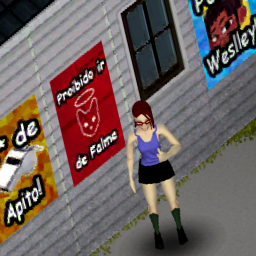

# Zomboid Mod Template

  

A practical template for Project Zomboid Build 42 mods using TypeScript-to-Lua and PipeWrench.

Use this template when you want:

- Build 42 packaging ready out of the box
- Steam Workshop preparation scripts
- Translation package generation scripts
- Jest mocks for PipeWrench APIs
- Build 42 type augmentation baseline

## Quick Start

1. Clone this repository and rename your mod values in [pipewrench.json](pipewrench.json).
2. Update metadata in [package.json](package.json).
3. Replace root assets in [src/root/logo.png](src/root/logo.png) and [src/root/poster.png](src/root/poster.png).
4. Update workshop metadata in [steam/workshop.md](steam/workshop.md).
5. Install tooling:

   npm install

6. Run tests:

   npm test

7. Build and package:

   npm run build

## Build Output Layout

After build, your mod is prepared at:

- dist/{modName}/
  - mod.info
  - 42/mod.info
  - 42/media/

Important:

- This template writes both Build 41-compatible and Build 42-compatible content into the same mod folder under dist/{modName}.
- Media is packaged into 42/media for Build 42.
- The postbuild step also patches generated Lua artifacts that can trigger noisy runtime warnings.

## Scripts You Will Use Most

- npm run build
  - Compiles TypeScript to Lua and runs postbuild packaging.
- npm run playtest
  - Rebuilds and deploys directly to ~/Zomboid/mods/{modName}.
- npm run steam
  - Prepares Workshop payload at ~/Zomboid/Workshop/{modName}.
- npm run zip
  - Generates a release zip from dist output.
- npm run translate -- <lang>
  - Creates a translation package from [src/translations-json/EN/UI.json](src/translations-json/EN/UI.json).
- npm run zip:translation -- <lang>
  - Zips a generated translation package.
- npm test
  - Runs Jest tests.

## Agent Support

This template ships with a custom coding agent profile for Copilot:

- [\.github/agents/project-zomboid-modder.agent.md](.github/agents/project-zomboid-modder.agent.md)

Use this agent when you want assistance focused on:

- TypeScript-to-Lua and PipeWrench mod development
- Build 42 packaging conventions
- Optional Build 41 compatibility handling (only when the repository already supports it)
- Jest test coverage for gameplay changes

## Repository Guide

- [src/client/example/Example.ts](src/client/example/Example.ts)
  - Event entrypoint pattern for client-side initialization.
- [src/client/example/api/ExampleAPI.ts](src/client/example/api/ExampleAPI.ts)
  - Example API/service-style module.
- [src/client/example/api/TSUIRedSquare.ts](src/client/example/api/TSUIRedSquare.ts)
  - Example UI element implementation.
- [src/test/mock.ts](src/test/mock.ts)
  - Global test setup and Build 42 runtime globals.
- [src/__mocks__/@asledgehammer/pipewrench/index.ts](src/__mocks__/@asledgehammer/pipewrench/index.ts)
  - PipeWrench mocks for deterministic tests.
- [src/zomboid.d.ts](src/zomboid.d.ts)
  - Build 42 type augmentations and globals.
- [scripts/postbuild.js](scripts/postbuild.js)
  - Build output normalization and asset wiring.
- [scripts/steam.js](scripts/steam.js)
  - Workshop folder generation.

## Translation Workflow

Source of truth translations live in JSON and are shared for both Build 41 and Build 42 outputs:

- [src/translations-json/EN/UI.json](src/translations-json/EN/UI.json)

Typical flow:

1. Add EN keys in JSON.
2. Run npm run translate -- pt (or another language).
3. Run npm run zip:translation -- pt.

## Testing

Example specs:

- [src/client/example/Example.spec.ts](src/client/example/Example.spec.ts)
- [src/client/example/api/exampleAPI.spec.ts](src/client/example/api/exampleAPI.spec.ts)
- [src/client/example/api/TSUIRedSquare.spec.ts](src/client/example/api/TSUIRedSquare.spec.ts)

Run:

- npm test
- npm run coverage

## Release Notes

- Use standard-version via npm run release.
- Postrelease is already wired to run zip.
